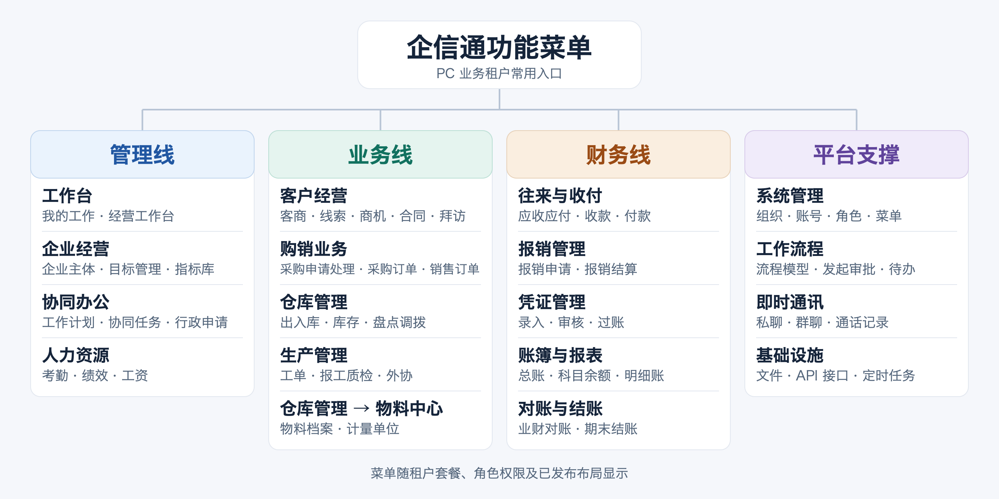
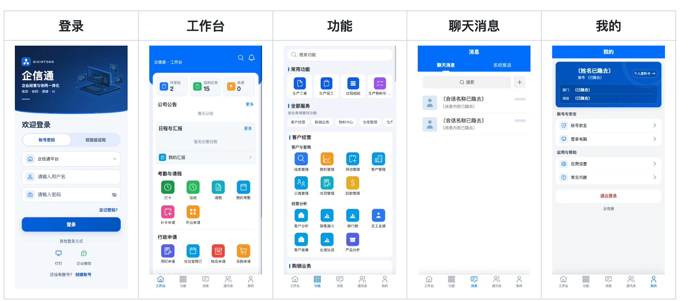

# 企信通 Qixintong 企业管理系统

**面向中小企业的企业管理系统，支持私有化部署和二次开发。源码商业授权 ¥4,980，一次性付费。**

企信通基于开源芋道 RuoYi-Vue-Pro 二次开发，提供 PC 管理端与移动 H5。企业信息管理覆盖 CRM 客户与合同、ERP 进销存、WMS 仓储、MES 生产、OA 协同办公、企业即时通讯（IM）、HRM 人事薪资和 FMS 财务核算。

销售从 CRM 合同创建订单，仓库出库后形成应收，财务登记到账并核销，再回查会计凭证。回款结果回写合同与分期，三个岗位都能追到同一笔业务。

适合希望把日常管理搬进同一套系统的企业。商贸企业可串起销售、采购、库存与财务，生产企业可管理工单、批次和成品入库。企业完成部署并配置业务角色后，管理者和员工可通过 PC 或手机浏览器办理已启用的业务。企业开发团队、独立开发者和学习者也可在授权范围内复用或修改源码。

[企业目标演示](docs/页面图集.md#企业目标从公司拆到个人) · [OA 系统选型](#开源-oa-系统选型) · [Java 和 Vue 审批示例](examples/oa-approval/) · [完整功能清单](docs/功能清单.md) · [PC 和 H5 页面图集](docs/页面图集.md) · [技术栈](#技术栈与运行环境) · [授权与交付](docs/交付与授权.md) · [微信咨询](#微信咨询)

## 按业务需求看功能

| 业务需求 | 企业部署后怎么用 |
| --- | --- |
| [OA 办公系统与工作流审批](#开源-oa-系统选型) | 员工从 PC 或手机发起采购、出差和报销申请，查看进度。审批人从待办办理。 |
| [企业即时通讯（IM）](#移动端界面) | 员工在 PC 和移动 H5 使用企业通讯录、私聊和群聊，并查看站内消息和系统通知。 |
| [企业目标管理](docs/页面图集.md#企业目标从公司拆到个人) | 管理者把公司目标逐级拆到部门和个人，再从个人目标生成计划、派发任务并验收。 |
| [ERP 进销存管理](docs/页面图集.md#采购与仓储) | 采购申请审批后可转订单。仓管办理收发货、库存盘点和调拨，按批次追查库存和原单。 |
| [业财一体化与财务管理](docs/页面图集.md#差旅报销与财务结算) | 销售出库形成应收，收款核销后回写合同。费用报销审批后，财务可按账套办理结算、实付和对账。 |
| [MES 生产管理](docs/页面图集.md#生产与委外) | 生产人员按工单领退料、报工、质检和办理成品入库。 |
| [HRM 人事考勤与薪资](docs/功能清单.md#经营目标与组织协作) | 人事管理考勤、绩效和工资条，员工从移动 H5 查看本人的记录。 |

例如，公司可以把年度经营目标下达到销售部，再拆成个人月目标。具备权限的人员把个人目标生成工作计划并派发任务，员工从 H5「我的任务」提交结果，发布人逐人验收，负责人继续提交目标成果供上级确认。[从目标拆解到个人执行的页面演示](docs/页面图集.md#企业目标从公司拆到个人)

## 开源 OA 系统选型

在评估开源 OA 系统时，有开发团队的企业可以从芋道公开源码中的组织、角色权限和 BPM 工作流开始，按自己的审批规则自建。[芋道 RuoYi-Vue-Pro 开源仓库](https://github.com/YunaiV/ruoyi-vue-pro)

企信通在这个开源底座上提供可私有部署的企业 OA 协同办公系统。工作流审批基于 Flowable BPM，流程管理员可配置审批流程和业务表单。企信通自有源码按商业授权交付。部署并配置业务角色后，企业可以使用以下流程。

- 员工可以发起**采购、出差和报销审批**并查看进度，审批人按角色办理。
- **个人月目标或周目标**可生成工作计划，由负责人派发任务。员工在 PC 或移动 H5 提交反馈，发布人逐人验收。
- 通过审批的采购申请可以**转 ERP 采购订单**，报销申请可以**进入财务结算、实付和对账**。

PC 与移动 H5 的具体入口见[协同办公功能清单](docs/功能清单.md#经营目标与组织协作)和[差旅报销页面演示](docs/页面图集.md#差旅报销与财务结算)。

### Java 和 Vue 审批示例

这个独立示例可以在本地运行，体验提交申请、查看待审批记录、通过或驳回。Java 提供审批接口，Vue 3 和 TypeScript 实现操作页面，示例数据保存在内存中。企信通正式产品的源码按商业授权交付。[查看示例代码和启动步骤](examples/oa-approval/)

## PC 与 H5 概览

### PC 常用功能菜单

### 移动端界面

## 企信通做了哪些开发

| 领域 | 新增或扩展的能力 |
| --- | --- |
| 主数据与统一仓库 | 建立客商档案、物料和本方企业主体。用映射关联 CRM 客户、ERP 客户和供应商及历史记录。采购、销售和生产共用统一库存，可按批次查流水和原单。 |
| 购销与财务 | 连接 CRM 合同及分期、ERP 订单、仓库收发、往来核销与 FMS 凭证。收款回写合同，付款区分审批与实际付款。退货、核销冲回及凭证更正可沿原单追溯。 |
| 生产与仓储 | 打通工单领料、线边库存、工序耗料、报工质检和成品分批签收。委外加工关联发料、回厂验收与余料退回。 |
| 目标与办公 | 增加公司、部门和个人目标管理。量化指标可逐级按月分解并核对分解差额，个人月目标或周目标可生成 OA 计划。计划再派发任务，由员工反馈、发布人按人验收。 |
| 客户拜访与计薪 | 增加客户拜访规则、移动打卡和指标月结。把确认后的拜访和符合条件的 OA 任务纳入 HRM 月度考核，保存工资试算所用的基数、系数及考核快照。 |
| 人事与薪资 | 修复 PC 工资条发放向导的模板加载、跨步骤选人和筛选名单。PC 和 H5 查看本人工资条明细前重新验证登录密码，发放通知仅提示办理状态。在 H5 补齐考勤申请入口并修复刷新后的返回路径。 |
| 财务账套与凭证 | 修复 H5 切换账套后可能显示旧账套数据的问题。补齐凭证过账、反过账和账簿筛选，完善账套初始化、成员授权、凭证移号和反结账校验。 |
| 报销与结算 | 串联出差申请、差旅报销、费用确认、出纳实付、清账凭证和银行流水对账。完善银行回单上传和查看，对账时核对银行金额、实际付款及已过账凭证金额。 |
| PC 工作台 | 分设个人工作台和经营工作台。员工集中办理待办与申请，管理者查看授权范围内的目标、经营指标和异常事项。租户可配置侧栏分组。 |
| H5 导航与页面重排 | 重新组织工作台、功能入口和个人中心，集中办公待办、协同任务与拜访任务。租户可在 PC 预览并发布 H5 布局。重排档案、绩效、工资条、财务单据和生产仓储页面。 |

近期的人事、财务修复和移动端调整详见[功能清单](docs/功能清单.md#近期修复与界面调整)。

芋道提供多租户、组织、权限、工作流及可复用的业务模块。企信通在此基础上建设主数据、统一仓库和经营目标，并扩展 CRM、ERP、MES、OA、HRM、FMS 等模块的业务规则和模块间交接。上游及第三方组件保留各自的许可和署名。[芋道 RuoYi-Vue-Pro](https://github.com/YunaiV/ruoyi-vue-pro)

## 从业务原单到下游结果

| 业务流程 | 可以沿哪些单据核对 |
| --- | --- |
| 销售到回款 | CRM 合同与分期 → ERP 销售订单 → 销售出库 → 应收 → 收款核销 → CRM 回写及会计凭证 |
| 采购到付款 | OA 采购申请 → 采购订单及审批 → 检验和采购入库 → 应付 → 付款审批 → 实付核销 → 凭证与账簿对账 |
| 库存到原单 | 采购、销售及生产收发 → 库存余额和批次 → 出入库流水 → 业务原单。盘点差异和调拨两侧库存各自留痕。 |
| 工单到成品入库 | BOM 与工艺路线 → 生产工单 → 领料及线边库存 → 报工与质检 → 成品分批入库 |
| 目标到任务验收 | 公司目标 → 部门与个人目标 → 计划 → 任务反馈与验收 → 目标达成结果 |
| 拜访到绩效工资 | 客户拜访任务及 OA 任务证据 → 月度指标 → 绩效冻结、评分及归档 → 工资试算、核算与工资条 |
| 报销到银行对账 | 日常或差旅报销 → 审批 → 费用确认与过账 → 实付 → 清账凭证 → 银行流水对账 |

角色、模板、业务策略和开通条件见[功能清单](docs/功能清单.md)。截图展示各环节的实际界面，请从[页面图集](docs/页面图集.md)查看。

## 技术栈与运行环境

| 部分 | 开发语言 | 技术栈 |
| --- | --- | --- |
| 服务端 | Java 25 | Spring Boot、Spring Security、MyBatis-Plus、Flowable、Maven |
| PC 管理端 | TypeScript | Vue 3、Vben Admin、Ant Design Vue、Vite |
| 移动 H5 | TypeScript | Vue 3、uni-app、unibest、Vite |
| 数据库与缓存 | SQL 初始化脚本 | MySQL 8、Redis |

PC 与 H5 共用同一套后端接口。企业可部署到自己的服务器，配置组织、角色、审批流程和账套，再开通所需模块。具体依赖版本和部署步骤随交付版本提供。

### English overview

Qixintong (企信通) is a self-hosted enterprise management system based on RuoYi-Vue-Pro. It connects office automation (OA) and approval workflows with CRM, ERP purchasing and sales, warehouse management (WMS), MES production, HRM payroll, and financial accounting. Enterprise instant messaging (IM) includes direct and group chat, an employee directory, and system notifications. The backend uses Java 25 and Spring Boot. The PC web client uses TypeScript and Vue 3. The mobile web client (H5) uses uni-app with Vue 3 and TypeScript. This repository contains product documentation, screenshots, and a [standalone approval example](examples/oa-approval/) in Java, Vue 3, and TypeScript. The product source code is licensed commercially.

## 为什么收费

只需要开源底座，或希望从头实现自己的一套流程，可以免费取得芋道公开源码，按其许可证自行开发。[访问芋道开源项目](https://github.com/YunaiV/ruoyi-vue-pro)

企信通的费用对应自有二开成果、跨模块集成和指定版本的发行交付。拿合同回款举例，从零搭建除了合同和收款两个页面，还要处理同一客商和企业主体的关联、批次库存、退货后的应收冲减、分期回款分配、会计账套和冲回。再用销售、仓管、出纳和会计的账号把流程跑一遍，检查原单、权限和金额是否一致。

用 AI 自建时，可以用同样的验收条件比较，按模型账单累计代码生成、联调、修复和回归各轮的用量。以 2026 年 11 月 16 日核对的 DeepSeek V4 Pro 高峰时段公开价为例，未命中缓存的输入每百万 Token ¥9，输出每百万 Token ¥27。假设自建累计用了 **4 亿未缓存输入 Token 和 6,000 万输出 Token**，仅模型费就是 **400 × ¥9 + 60 × ¥27 = ¥5,220**，超过 ¥4,980 的授权价。这是预算情景，实际费用随模型、缓存、时段和用量变化。测算也未包含人工审查、业务验收和部署。[DeepSeek 官方模型与价格](https://api-docs.deepseek.com/zh-cn/quick_start/pricing/)

## 授权与交付

**¥4,980 一次性付费，授权一个实名个人或一个企业主体。** 在协议约定范围内，可以学习、二次开发、自行部署，也可以用于书面确认的一个终端客户项目并交付部署成品。终端客户需要接手企信通自有源码时，须另行取得授权。

| 项目 | 内容 |
| --- | --- |
| 源码 | 后端、PC 管理端、移动 H5 的指定版本及版本记录。 |
| 部署材料 | 环境和构建说明、适用的数据库初始化材料、合成样例与验收流程。 |
| 使用期限 | 在约定范围内长期使用所购版本。代部署、定制开发、培训和未来版本升级可另行约定。 |
| 第三方组件 | 依各自许可证使用和分发。原生 App、RTC、云推送及对应外部服务的可用平台、配置和交付内容单独确认。 |
| 自有内容许可 | 协议约定授权范围。禁止未经授权公开上传、转售或转授权企信通自有源码及包含这些代码的二开源码。 |

源码通过授权约定的渠道交付。具体材料和验收流程见[交付与授权说明](docs/交付与授权.md)。

### 版本与交付

本仓库公开产品文档、页面图集和独立审批示例。首发交付版本与空库安装流程仍在准备，现阶段可咨询及预约演示。下单前确认目标流程、运行环境、可交付版本和验收方式。

### 微信咨询

微信扫码联系，预约产品演示，咨询企业部署和源码授权。

也可通过 [GitHub Issues](https://github.com/huang4095/qixintong-product/issues/new) 提交公开问题。
