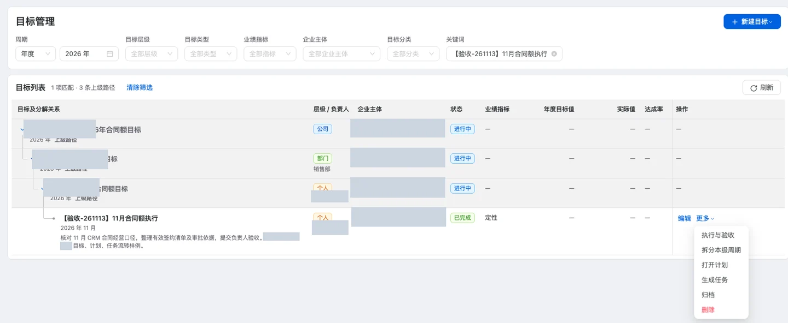
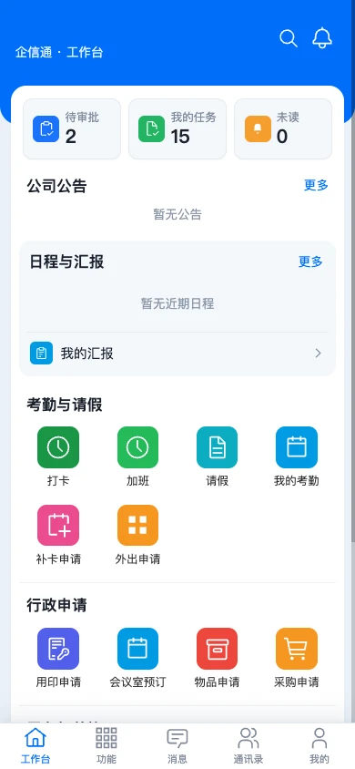
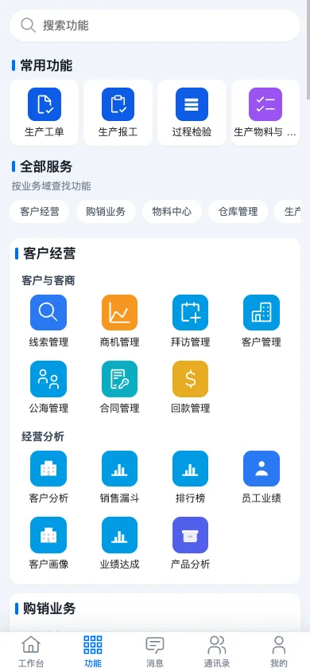
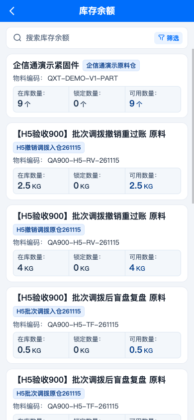

# 企信通企业业务系统

**可私有部署、可二次开发的企业业务源码。一次性商业授权 ¥4,980。**

企信通基于芋道 RuoYi-Vue-Pro 二次开发，提供后端、PC 管理端与移动 H5。销售从 CRM 合同创建订单，仓库出库后形成应收，财务登记到账并核销，再回查会计凭证。回款结果回写合同与分期，三个岗位都能追到同一笔业务。

适合需要搭建企业内部系统的技术团队、为客户做定制项目的独立开发者，以及想学习企业系统如何处理权限、库存和财务的开发者。

[完整功能清单](docs/功能清单.md) · [PC 和 H5 页面图集](docs/页面图集.md) · [授权与交付](docs/交付与授权.md) · [预约演示](https://github.com/huang4095/qixintong-product/issues/new)

| 移动工作台 | 功能导航 | 库存余额 |
| :---: | :---: | :---: |
|  |  |  |

## 企信通做了哪些开发

| 领域 | 新增或扩展的能力 |
| --- | --- |
| 主数据与统一仓库 | 建立客商档案、物料和本方企业主体。用映射关联 CRM 客户、ERP 客户和供应商及历史记录。采购、销售、生产和项目领退料共用统一库存，可按批次查流水和原单。 |
| 购销与财务 | 连接 CRM 合同及分期、ERP 订单、仓库收发、往来核销与 FMS 凭证。收款回写合同，付款区分审批与实际付款。退货、核销冲回及凭证更正可沿原单追溯。 |
| 生产与仓储 | 打通工单领料、线边库存、工序耗料、报工质检和成品分批签收。委外加工关联发料、回厂验收与余料退回。 |
| 目标与办公 | 增加公司、部门和个人目标管理。个人月目标或周目标可生成 OA 计划，计划再派发任务，由员工反馈、发布人按人验收。 |
| 客户拜访与计薪 | 增加客户拜访规则、移动打卡和指标月结。把确认后的拜访和符合条件的 OA 任务纳入 HRM 月度考核，保存工资试算所用的基数、系数及考核快照。 |
| 报销与结算 | 串联出差申请、差旅报销、费用确认、出纳实付、清账凭证和银行流水对账。费用可关联项目及主体账套，申请人能回查办理进度。 |
| 项目建设 | 增加面向场站的项目模板、施工队授权、节点验收和移交。将项目领退料接至统一仓库，将项目费用接至 OA 和财务。 |
| PC 和 H5 协作 | 增加个人工作台、经营工作台与租户菜单布局。角色决定可操作的菜单和按钮，数据范围及企业主体、账套权限决定可办理的单据。两端共用后端。 |

芋道提供多租户、组织、权限、工作流及可复用的业务模块。企信通在此基础上建设主数据、统一仓库、经营目标和场站建设，并扩展 CRM、ERP、MES、OA、HRM、FMS 等模块的业务规则和模块间交接。上游及第三方组件保留各自的许可和署名。[芋道 RuoYi-Vue-Pro](https://github.com/YunaiV/ruoyi-vue-pro)

## 从业务原单到下游结果

| 业务流程 | 可以沿哪些单据核对 |
| --- | --- |
| 销售到回款 | CRM 合同与分期 → ERP 销售订单 → 销售出库 → 应收 → 收款核销 → CRM 回写及会计凭证 |
| 采购到付款 | OA 采购申请 → 采购订单及审批 → 检验和采购入库 → 应付 → 付款审批 → 实付核销 → 凭证与账簿对账 |
| 库存到原单 | 采购、销售、生产及项目收发 → 库存余额和批次 → 出入库流水 → 业务原单。盘点差异和调拨两侧库存各自留痕。 |
| 工单到成品入库 | BOM 与工艺路线 → 生产工单 → 领料及线边库存 → 报工与质检 → 成品分批入库 |
| 目标到任务验收 | 公司目标 → 部门与个人目标 → 计划 → 任务反馈与验收 → 目标达成结果 |
| 拜访到绩效工资 | 客户拜访任务及 OA 任务证据 → 月度指标 → 绩效冻结、评分及归档 → 工资试算、核算与工资条 |
| 报销到银行对账 | 出差、日常或项目报销 → 审批 → 费用确认与过账 → 实付 → 清账凭证 → 银行流水对账 |
| 施工到移交 | 项目模板 → 选队与授权 → 施工签到、日报和节点照片 → 节点完工与移交。领退料和费用可回查相应业务单据。 |

角色、模板、业务策略和开通条件见[功能清单](docs/功能清单.md)。截图展示各环节的实际界面，请从[页面图集](docs/页面图集.md)查看。

## 为什么收费

只需要开源底座，或希望从头实现自己的一套流程，可以免费取得芋道公开源码，按其许可证自行开发。[访问芋道开源项目](https://github.com/YunaiV/ruoyi-vue-pro)

企信通的费用对应自有二开成果、跨模块集成和指定版本的发行交付。拿合同回款举例，从零搭建除了合同和收款两个页面，还要处理同一客商和企业主体的关联、批次库存、退货后的应收冲减、分期回款分配、会计账套和冲回。再用销售、仓管、出纳和会计的账号把流程跑一遍，检查原单、权限和金额是否一致。

用 AI 自建时，可以用同样的验收条件比较，按模型账单累计代码生成、联调、修复和回归各轮的用量。以 2026 年 11 月 16 日核对的 DeepSeek V4 Pro 高峰时段公开价为例，未命中缓存的输入每百万 Token ¥9，输出每百万 Token ¥27。假设自建累计用了 **4 亿未缓存输入 Token 和 6,000 万输出 Token**，仅模型费就是 **400 × ¥9 + 60 × ¥27 = ¥5,220**，超过 ¥4,980 的授权价。这是预算情景，实际费用随模型、缓存、时段和用量变化。测算也未包含人工审查、业务验收和部署。[DeepSeek 官方模型与价格](https://api-docs.deepseek.com/zh-cn/quick_start/pricing/)

## 授权与交付

**¥4,980 一次性付费，授权一个实名个人或一个企业主体。** 在协议约定范围内，可以学习、二次开发、自行部署，也可以用于书面确认的一个终端客户项目并交付部署成品。终端客户需要接手企信通自有源码时，须另行取得授权。

| 项目 | 内容 |
| --- | --- |
| 源码 | 后端、PC 管理端、移动 H5 的指定版本及版本记录。 |
| 部署材料 | 环境和构建说明、适用的数据库初始化材料、合成样例与验收流程。 |
| 使用期限 | 在约定范围内长期使用所购版本。代部署、定制开发、培训和未来版本升级可另行约定。 |
| 第三方组件 | 依各自许可证使用和分发。原生 App、RTC、云推送、施工小程序及对应外部服务的可用平台、配置和交付内容单独确认。 |
| 自有内容许可 | 协议约定授权范围。禁止未经授权公开上传、转售或转授权企信通自有源码及包含这些代码的二开源码。 |

后端为 Java 25、Spring Boot、MySQL 8、Redis 与 Flowable。PC 使用 Vue 3、TypeScript 和 Vben Admin。移动 H5 使用 uni-app 和 unibest。源码通过授权约定的渠道交付。具体材料和验收流程见[交付与授权说明](docs/交付与授权.md)。

### 版本与咨询

本仓库公开产品文档和页面图集。首发交付版本与空库安装流程仍在准备，现阶段可咨询及预约演示。下单前确认目标流程、运行环境、可交付版本和验收方式。

可通过 [GitHub Issues](https://github.com/huang4095/qixintong-product/issues/new) 咨询演示、功能和交付范围。请勿在公开讨论中填写手机号、采购信息或部署凭据。
