# 企信通页面图集

[返回产品介绍](../README.md) · [查看功能清单](功能清单.md)

这里是企信通 PC 管理端和移动 H5 的实际页面截图，来自不同批次的验收记录。图片按业务环节排列，人员、主体和部分单据字段已脱敏。点击图片查看大图。

[移动工作台](#移动工作台) · [经营目标与任务](#经营目标与任务) · [销售与应收](#销售与应收) · [采购与仓储](#采购与仓储) · [生产与委外](#生产与委外) · [差旅报销与财务结算](#差旅报销与财务结算) · [场站建设](#场站建设)

## 移动工作台

| 工作台 | 功能入口 | 消息 |
| --- | --- | --- |
| [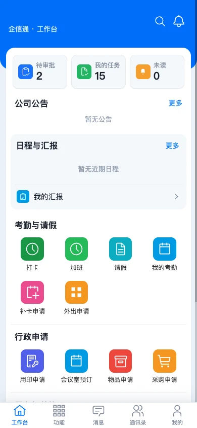](assets/screenshots/h5-workbench.webp) | [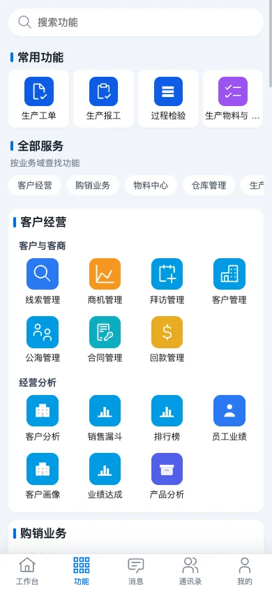](assets/screenshots/h5-functions.webp) |  |
| 查看待审批、我的任务和日程，办理考勤与行政申请。 | 按业务域查找客户、采购、库存和生产功能。 | 查看聊天会话和系统推送。 |

## 经营目标与任务

### PC 目标管理

[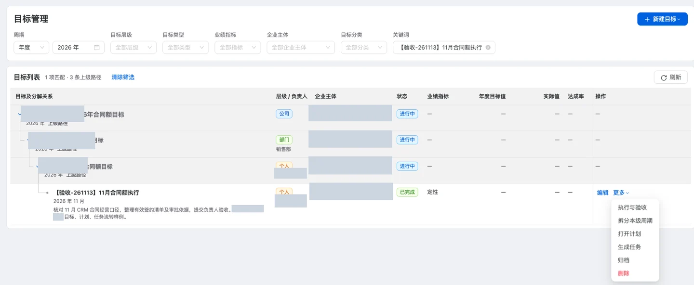](assets/screenshots/pc-goal-hierarchy.webp)

按公司、部门和个人查看目标分解关系、达成进度及执行入口。

### PC 从计划生成任务与任务验收

| 生成任务 | 任务详情 |
| --- | --- |
| [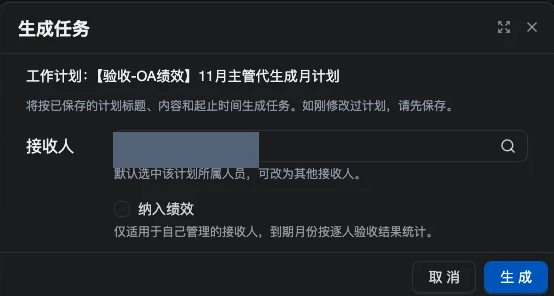](assets/screenshots/pc-plan-task.webp) | [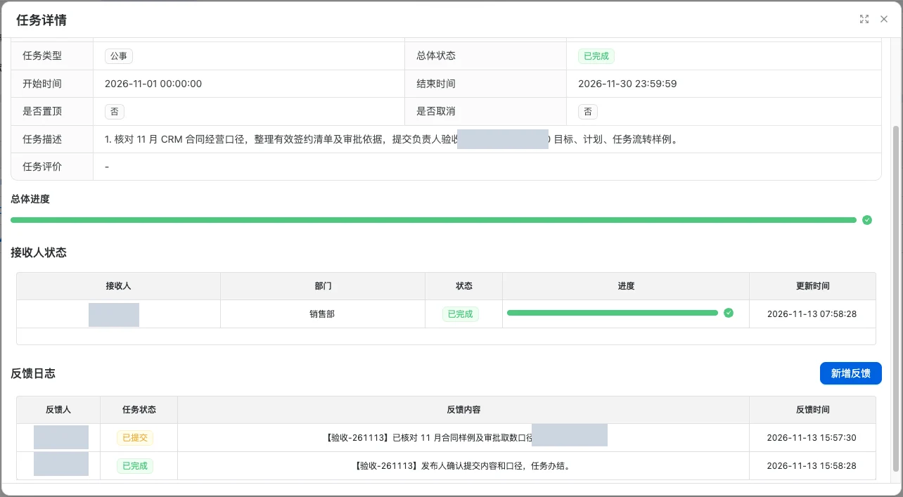](assets/screenshots/pc-task-completion.webp) |
| 从工作计划选择任务接收人，并按需纳入绩效。 | 查看接收人进度、执行反馈和完成状态。 |

## 销售与应收

| H5 合同管理 | H5 销售出库 |
| --- | --- |
| [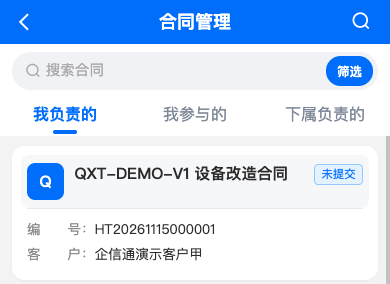](assets/screenshots/h5-contract-demo.webp) | [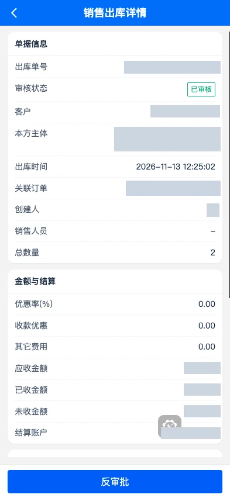](assets/screenshots/h5-sales-delivery.webp) |
| 按负责范围查看合同和审核状态，图中为演示合同。 | 核对关联销售订单、履约数量和应收、已收、未收字段。 |

### PC 应收账款

[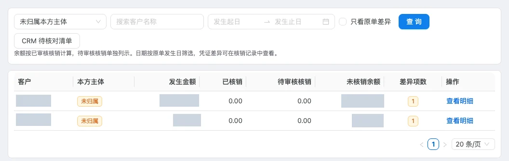](assets/screenshots/pc-receivables.webp)

查询应收发生额、核销状态和未核销余额，可定位待核对单据。

## 采购与仓储

### PC 采购订单审批

[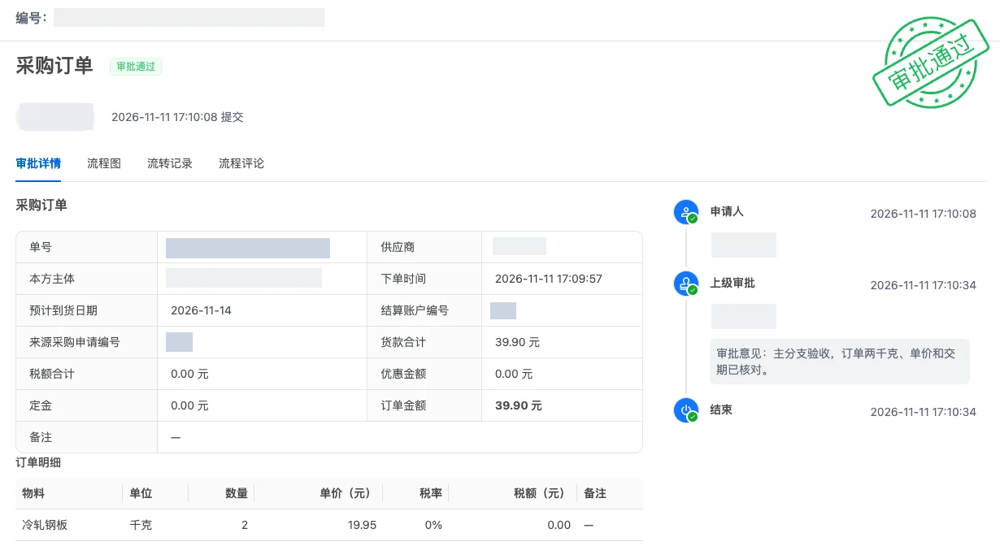](assets/screenshots/pc-purchase-approval.webp)

在同一页查看采购订单明细、关联申请和审批流转记录。

| H5 新增采购入库 | H5 库存余额 | H5 盲盘实盘 |
| --- | --- | --- |
| [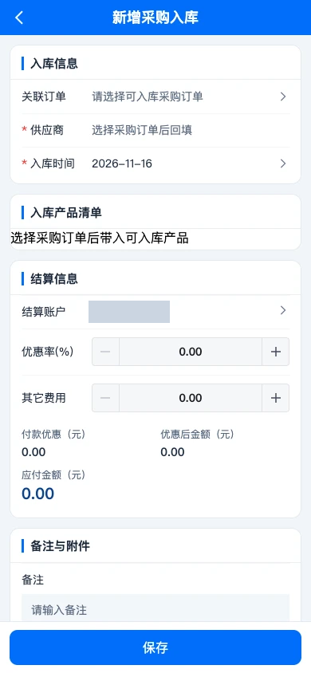](assets/screenshots/h5-purchase-receipt.webp) | [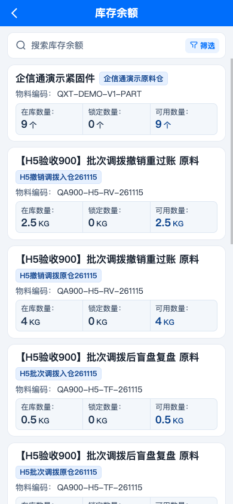](assets/screenshots/h5-stock-balance.webp) | [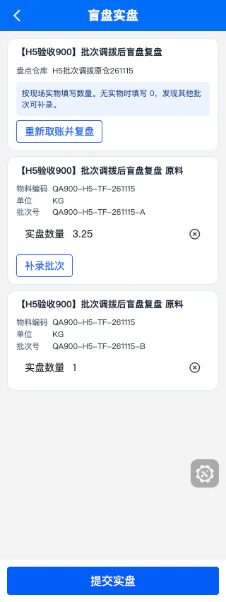](assets/screenshots/h5-stock-count.webp) |
| 选择采购订单并带入入库产品。 | 按仓库和物料查看在库、锁定和可用数量。 | 按批次录入实盘数量并提交盘点。 |

### PC 库存调拨

[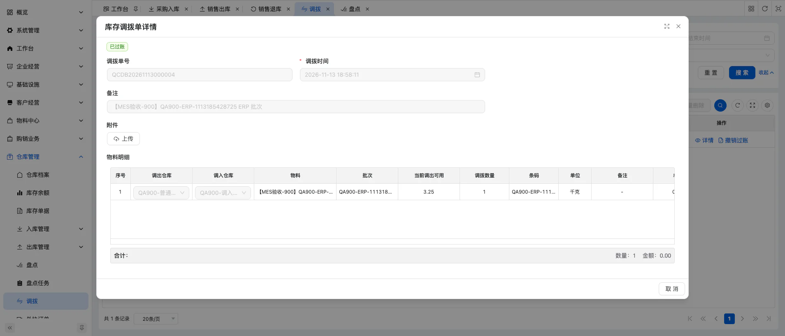](assets/screenshots/pc-stock-transfer.webp)

核对调出仓、调入仓、物料批次、数量和过账状态。

## 生产与委外

### PC 生产工单

[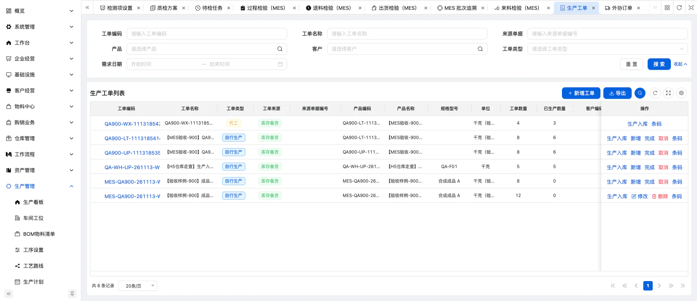](assets/screenshots/pc-production-orders.webp)

按自制或代工查看工单、产品和生产数量，可进入生产入库。

| H5 生产入库 | H5 外协发料与回厂 |
| --- | --- |
| [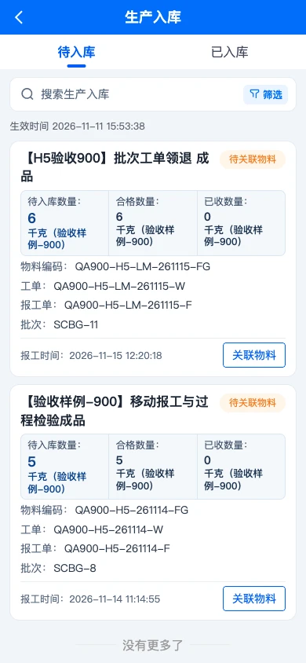](assets/screenshots/h5-production-receipt.webp) | [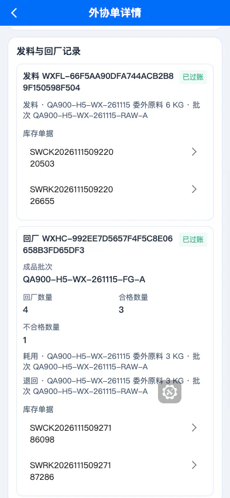](assets/screenshots/h5-outsource-receipt.webp) |
| 核对合格产出、待入库数量、来源工单与报工记录。 | 回查发料、成品批次、回厂数量和已过账库存单据。 |

## 差旅报销与财务结算

| H5 差旅报销 | H5 报销结算明细 |
| --- | --- |
| [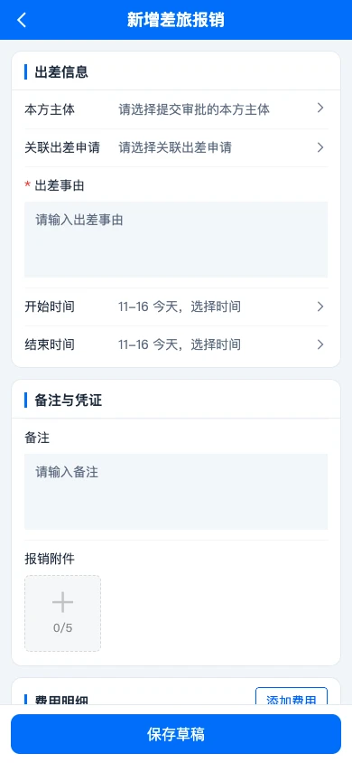](assets/screenshots/h5-travel-reimbursement.webp) | [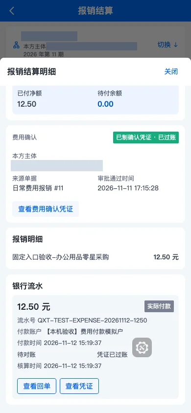](assets/screenshots/h5-expense-reconciliation.webp) |
| 关联出差申请，填写费用、行程和报销凭证。 | 回查费用确认凭证、实付流水与对账状态。 |

## 场站建设

[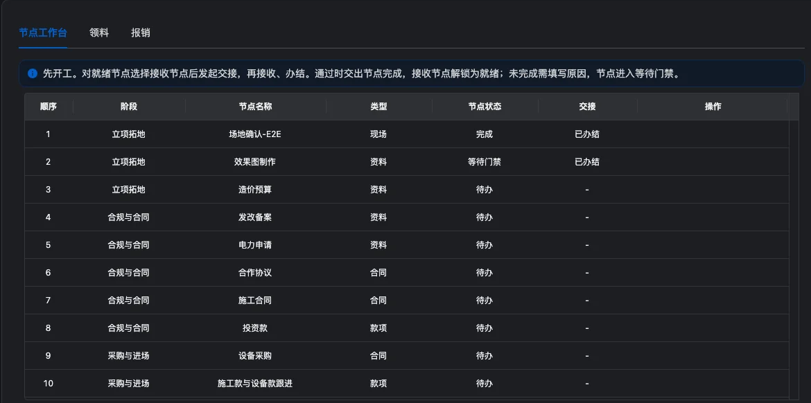](assets/screenshots/pc-project-workbench.webp)

项目经理按施工阶段查看节点、完成状态与交接情况，并从项目页查看领料及报销记录。

[返回产品介绍](../README.md) · [查看功能清单](功能清单.md)
